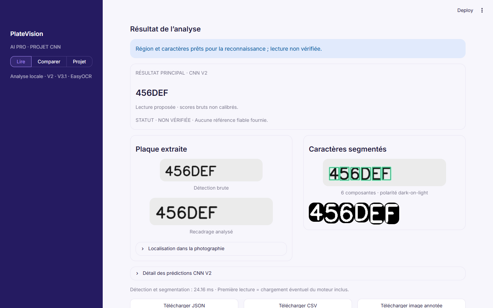

# PlateVision AI Pro

An academic license plate recognition mini-project built with OpenCV, two custom character CNNs and optional EasyOCR. The local Streamlit app shows detection, crop, segmented characters and proposed readings; it never treats a raw model score as proof that a plate was read correctly.



Interface captures: [three-engine comparison](assets/ui_comparison_desktop.png), [project overview](assets/ui_about_desktop.png), [mobile preview](assets/ui_analysis_mobile.png). All use a fabricated plate; no private photograph is included.

## Method

`JPG/PNG → plate detection or manual crop → perspective crop → character segmentation → CNN V2 / CNN V3.1`, with EasyOCR reading the raw crop independently. Both CNNs classify **one of 36 characters** (`0–9`, `A–Z`) from a 32×32 grayscale tensor. V2 uses four convolution layers (32, 64, 128, 128 filters), batch normalization, pooling, a 128-unit dense layer and dropout. V3.1 has its own preprocessing and frozen checkpoint. No training occurs in the app.

The authentic V1/V2 notebook generated **18,000 synthetic glyphs** from seven available font files with size, position, rotation and occasional blur variation. It split by font ID into 10,264 training, 2,548 validation and 5,188 test samples. The code and original outputs are available as a [privacy-trimmed authentic excerpt](notebooks/PlateVision_AI_Training_V1_V2_authentic_excerpt.ipynb). Exact font filenames and hashes were not recorded, so the dataset cannot be reproduced byte-for-byte. The [V3](notebooks/PlateVision_AI_CNN_V3_Ready.ipynb) and [V3.1](notebooks/PlateVision_AI_CNN_V3_1_Ready.ipynb) files are authentic source notebooks without stored execution outputs; their presence does not establish independently measured training results. A later reconstructed V1/V2 notebook was removed from this academic release to avoid confusing its results with the historical run.

| Evidence | Measured result | Interpretation |
| --- | --- | --- |
| Historical V1/V2 synthetic **test** | 57.36% / 80.65% character accuracy | Same 5,188 isolated glyphs; no plate detection in this metric |
| Supplied V3.1 synthetic Lato **validation** | 98.17% accuracy; 98.15% macro F1 | Different dataset and evaluation stage; cannot be compared as a measured V2→V3.1 gain |
| One private photo, reference `J389NLT` | V2 `N3M9NLT`; V3.1 `J3BSNLT`; EasyOCR `J389NLT` | One local observation, not a real-photo accuracy estimate; neither CNN read the whole plate correctly |

The reserved V3.1 DejaVu final test remains unevaluated because its exact fonts and generation environment are unavailable here. V3.1 classified 33 of 100 zeros as `O` in the supplied Lato validation. Real-photo generalization remains unmeasured without an independent authorized dataset. Methodology and inference limits are recorded in [ML documentation](DOCUMENTATION_ML.md).

## Run locally

Verified on Windows with Python 3.12. From the project root:

```powershell
py -3.12 -m venv .venv
.\.venv\Scripts\python.exe -m pip install -r requirements.txt
.\.venv\Scripts\python.exe -m streamlit run app.py
```

Open the URL printed by Streamlit (usually `http://localhost:8501`). Upload the included [synthetic vehicle example](assets/demo_synthetic_vehicle.png), select automatic detection and optionally enter `456DEF` as a reference. The generated example demonstrates operation, not real-world accuracy. Uploads are limited to 15 MB and 20 million pixels. The app also supports a manual crop when detection fails.

EasyOCR is optional. Install it and explicitly download its checksum-verified official weights before selecting that engine; ordinary inference never downloads weights:

```powershell
.\.venv\Scripts\python.exe -m pip install -r requirements-ocr.txt
.\.venv\Scripts\python.exe -m scripts.download_easyocr
```

## Validate and deliver

```powershell
.\.venv\Scripts\python.exe -m pip install pytest
.\.venv\Scripts\python.exe -m pytest -q
.\.venv\Scripts\python.exe -m scripts.validate_v21
.\.venv\Scripts\python.exe -m scripts.validate_v32
```

Build the curated ZIP with `python -m scripts.build_release_1_0`. The archive excludes the optional local real-photo fixture `images.jpg`, generated validation output, caches, secrets and development wheels. Four real-photo regression checks run only when that private image is placed at the project root. Source code is published at [GitHub](https://github.com/1liaaasx/platevision-ai-pro); no cloud deployment is claimed. No project LICENSE has been selected, so public availability does not grant reuse rights. The repository owner is responsible for the redistribution rights of the CNN weights, notebooks and screenshots.
