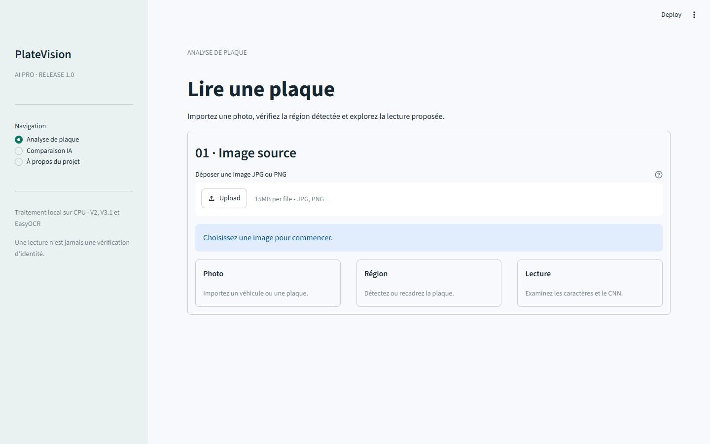

# PlateVision AI Pro · version 1.0

Application expérimentale de lecture de plaques sous Streamlit. Elle détecte une région avec OpenCV, segmente les caractères et compare deux CNN fournis. EasyOCR est facultatif. Les résultats sont des propositions de lecture, jamais une vérification d'identité ni une mesure de fiabilité sur des véhicules réels.

## Démonstration locale

Environnement vérifié à l'origine : Windows et Python 3.12. Installer `requirements.txt`, puis lancer `streamlit run app.py`. Ouvrir `assets/demo_synthetic_vehicle.png` dans l'application et utiliser la référence synthétique `456DEF`. Les modèles CNN V2 et V3.1 sont livrés dans `models/` ; leurs empreintes figurent dans `REPRODUCIBILITY.md`.

EasyOCR nécessite en plus `requirements-ocr.txt` et une exécution explicite de `python -m scripts.download_easyocr`. Ses poids restent hors du dépôt. Sans ces dépendances, les deux CNN restent utilisables.

## Portée des résultats

Le résultat historique V2 est de 80,65 % sur des caractères synthétiques isolés ; V3.1 affiche 98,17 % sur une autre validation synthétique. Les protocoles diffèrent, et aucune précision sur des plaques réelles n'est établie. Lire `DOCUMENTATION_ML.md` et `MODEL_CARD.md` avant de réutiliser les résultats.

## GitHub et hébergement Streamlit

Cette copie est un **candidat local à examiner**. Elle n'a pas été publiée ni testée sur Streamlit Community Cloud. La publication du code sur GitHub et l'hébergement de l'application sont deux étapes distinctes. Le point d'entrée est `app.py`, avec `requirements.txt` à la racine. Un premier essai cloud doit porter sur les CNN ; EasyOCR nécessite un essai séparé pour ses dépendances, ses poids et la mémoire disponible. Les images téléversées sur une application hébergée sont traitées sur le serveur de cet hébergement : n'envoyer que des images autorisées.

La photographie privée utilisée pendant le développement, sa plaque et les diagnostics associés sont exclus. Aucun fichier de police ni poids EasyOCR ne figure dans cette copie. Aucun `LICENSE` n'est fourni : les droits de redistribution des deux checkpoints CNN, des actifs et du code doivent être confirmés par le propriétaire avant publication. Choisir explicitement la visibilité du dépôt et celle de l'application avant toute mise en ligne.

## Vérification

Avec les dépendances installées, lancer `python -m pytest -q`. Les contrôles du dossier `benchmark_real/` attendent des images et annotations autorisées ; le jeu d'exemple est vide et ne fournit donc aucun score réel.
